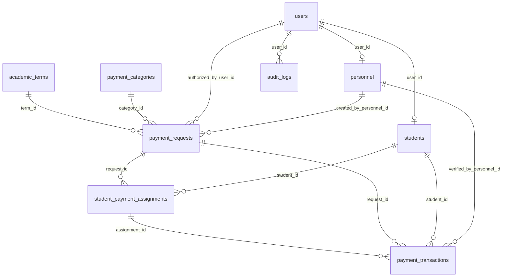

# COE-Pay: Centralized Payment Authorization, Collection, and Monitoring System
**Institution:** ICCT Colleges Foundation, Inc.  
**Department:** College of Engineering and Digital Technology (COE)  
**Target DBMS:** MySQL 8.0+ / MariaDB 10.4+ (`utf8mb4_unicode_ci`)  
**Frontend:** HTML5, CSS3, Vanilla JavaScript, FontAwesome Icons, Google Fonts (`Inter`)

---

## 🏛️ System Overview

**COE-Pay** is a robust, academic financial management and student clearance web application tailored for the College of Engineering and Digital Technology at ICCT Colleges. It resolves collection discrepancies, streamlines departmental fee authorizations, enforces GCash reference verification, and produces official examination clearance vouchers.

### Key Capabilities
1. **Dean & Administrative Governance:**
   - Review and authorize or reject payment requests submitted by faculty and organization officers.
   - Automatic generation of student payment obligations upon request approval.
   - Comprehensive student roster management (enrollment, cohort filtering, clearance tracking).
   - Real-time immutable audit trail for every authorization, submission, and verification.
   - 1-click **Export MySQL Database Dump (`.sql`)** and **Institutional Financial Report (`.csv`)**.
2. **Department Personnel & Treasurers:**
   - Create targeted payment requests (by year level: 1st, 2nd, 3rd, 4th, or specific sections like `BSCpE-4A`).
   - Configure official GCash receiver accounts with interactive QR codes.
   - Review submitted GCash receipts in an interactive inspection lightbox with duplicate reference validation.
   - Real-time section collection sheets and class compliance tracking.
3. **Student Financial Portal:**
   - Live dashboard of outstanding obligations, paid fees, and approaching/overdue deadlines.
   - Interactive GCash payment modal with QR code, 1-click account copy, and 13-digit reference number verification.
   - Official downloadable / printable **COE Payment Clearance Certificate & Receipt Voucher** with institutional seal, authorized signature blocks, and verification metadata.

---

## 🗄️ Database Architecture & Relational Schema

The database strictly adheres to the 9-table schema defined in `sql/coepay_schema.sql`:



### Tables Overview
1. `academic_terms` - Term cycles (e.g., `2026-2027 1st Semester`), active semester indicator (`is_current`).
2. `users` - Core credentials, role-based authorization (`admin`, `personnel`, `student`), account active status.
3. `students` - Student information linked to `users`, ICCT student ID number, program (`BSCpE`), year level, section.
4. `personnel` - Faculty/treasurer profile linked to `users`, employee ID, designation, department.
5. `payment_categories` - Fee classifications (Org Fee, Capstone Project, Lab Maintenance, Uniform, Summit).
6. `payment_requests` - Payable dues with amounts, deadlines, cohort targeting, GCash account details, status machine (`draft` -> `pending_authorization` -> `authorized` / `rejected` / `closed`).
7. `student_payment_assignments` - Relational mapping between students and authorized requests with statuses (`unpaid`, `pending_verification`, `paid`, `overdue`).
8. `payment_transactions` - Submitted payment records containing unique 13-digit GCash reference numbers (`uq_gcash_ref`), sender information, amount, timestamps, receipt image references, and verification remarks.
9. `audit_logs` - Immutable audit ledger logging user actions, entities modified, client IP addresses, and timestamps.

---

## 🔑 Pre-Configured Test Accounts

All accounts use the standard test password: `password123`

### 🏛️ The Four Core System Roles

COE-Pay features a **single unified login interface** that automatically authenticates users and routes them to their dedicated, role-specific dashboard:

| Role | Name | Username | Password | Core Responsibilities & Dashboard Capabilities |
| :--- | :--- | :--- | :--- | :--- |
| **System Developer** | **Dave Guiyab** | `developer` | `password123` | Responsible for building a system that works properly and helps people perform their tasks more efficiently. Access to system health diagnostics, database table inspector, sandbox testing runner, and audit log monitor. |
| **Head Engineer / Coordinator** | **Engr. Ivanlee Mendoza** | `engr.mendoza` | `password123` | Approve request, add student, bulk upload student masterlist (.csv/.xlsx), monitor departmental compliance, and manage payment categories. |
| **Officer** | **Pearl Catequista** | `officer` | `password123` | Request for adding items, seminars, and other fees; inspect student GCash payment receipts, verify transactions, and monitor section collection sheets. |
| **Student** | **Christian Dave Guiyab** | `2023-10001` | `password123` | Purchase, paying, ordering. Browse payable dues, submit GCash payments with QR code and 13-digit reference number, and download official COE examination clearance certificates. |

> 💡 **Tip:** Use the **Fast Demo Switcher** dropdown in the top right navigation bar to jump between any of the 4 roles instantly!

---

## 🚀 How to Run the Application

### Option A: Zero-Dependency Local Server (Recommended)
Double-click `start-server.bat` or run the following in PowerShell:
```powershell
powershell -ExecutionPolicy Bypass -File start-server.ps1
```
The server will start on `http://localhost:8080/` and automatically launch your browser.

### Option B: Direct Browser Opening
Simply double-click `index.html` or open it with Google Chrome, Microsoft Edge, or Mozilla Firefox.

### Option C: Production Deployment (XAMPP / LAMP / MariaDB)
1. Copy the `coepay1` directory into your web root (e.g. `C:\xampp\htdocs\coepay`).
2. Open phpMyAdmin or MySQL CLI and import `sql/coepay_schema.sql`:
   ```bash
   mysql -u root -p < sql/coepay_schema.sql
   ```
3. Configure `api/config.php` with your database credentials.
4. Access `http://localhost/coepay/` in your browser.

---

## 🛠️ Key Workflows

### 1. Payment Request & Dean Authorization Workflow
1. Log in as **Engr. Santos** (`engr.santos`).
2. Click **"New Payment Request"**, fill out the details (e.g., *Capstone Defense Fee* for *Year 4 BSCpE-4A*), and submit for authorization.
3. Switch to **Dean / Admin** (`admin`).
4. In the **Payment Authorizations** tab, review the request. Click **"Authorize"** and provide remarks.
5. COE-Pay automatically generates unpaid obligations for all eligible students matching the selected year level and section!

### 2. Student Payment & GCash Submission Workflow
1. Log in as **Juan Dela Cruz** (`2023-01042`).
2. In **My Payment Obligations**, click **"Pay via GCash"**.
3. View the QR code and GCash details, enter the 13-digit GCash reference number (or click *"Use Test Reference"*), verify sender details, and click **"Submit Payment for Verification"**.
4. The assignment status updates to **"Verification in Progress"**.

### 3. Personnel Verification & Clearance Generation
1. Switch to **Engr. Santos** (`engr.santos`).
2. In the **Verification Queue**, click **"View Receipt"** to open the GCash receipt inspection modal.
3. Verify the details and click **"Approve & Issue Official Clearance"**.
4. Switch back to **Juan Dela Cruz**. Under **Receipts & Clearance Certificates**, click **"Print Official Certificate"** to view and print the official signed COE clearance voucher.

---

## 🛡️ Anti-Fraud & Security Guarantees
- **Duplicate Prevention:** Reference numbers are checked against all existing transactions; duplicate entries are rejected instantly.
- **Relational Integrity:** Foreign keys cascade and protect against orphaned records.
- **Audit Logging:** Every login, payment attempt, authorization, and verification writes an immutable log record with IP, user ID, and timestamp.
